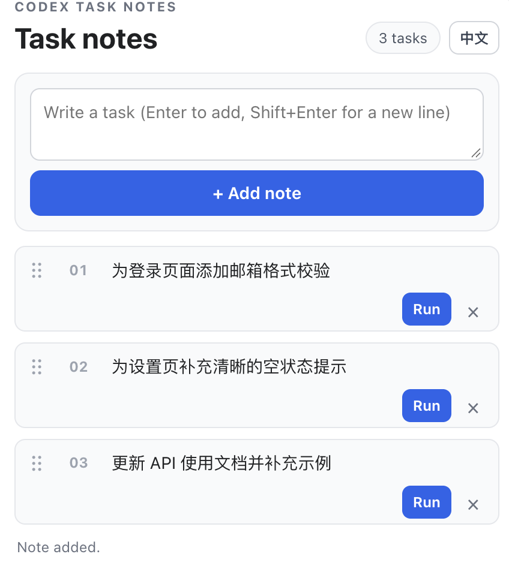

# 📝 Codex Task Queue Notes

[中文说明](README.md)

> **Turn scattered to-dos into a queue Codex can work through.** Write a note, drag to prioritize, and click **Run** to send it to the current conversation. Completed tasks are archived automatically.

🌏 Bilingual UI　·　↕️ Drag to reorder　·　💾 Stored locally

A lightweight way to break a project into focused steps and move through them one at a time.

## 👀 Preview



> Switch interface language in the top-right corner; task notes can be written in any language.

## ✨ Highlights

- 🗒️ **Sticky-note tasks:** add, edit, and delete single-field notes.
- ↕️ **Drag to prioritize:** reorder notes with the left handle; active tasks are numbered automatically.
- ▶️ **Hand off with one click:** send a note as a user message to the current conversation, then archive it after a successful send.
- 🌐 **Chinese and English UI:** switch labels, buttons, hints, and status messages; the choice is remembered locally.
- 🔒 **Local queue:** task contents and order stay under the current Codex home and are not synced across users or devices.

## ⚙️ Requirements

- A Codex client that supports local plugins and MCP Apps.
- Node.js available as `node` on `PATH`; no npm dependencies are required.

The plugin runs a local `stdio` MCP server for local Codex clients. It is not a hosted remote MCP service.

## 🚀 Install from GitHub

```bash
codex plugin marketplace add https://github.com/97ming/codex-task-queue-notes.git
codex plugin add codex-task-queue-spike@task-queue-spike-local
```

Restart Codex after installation, then call `open_task_queue_board` in a conversation to open the notes board.

After updating the repository, refresh the marketplace and reinstall the plugin:

```bash
codex plugin marketplace upgrade task-queue-spike-local
codex plugin add codex-task-queue-spike@task-queue-spike-local
```

## 🧭 How to use it

1. Call `open_task_queue_board` to open the board.
2. Write a task in the top field. Press **Enter** to add it or **Shift+Enter** for a new line.
3. Click a note to edit it, or drag the left handle to reorder it.
4. Click **Run** to send it to the current conversation. Successfully sent tasks move to the archive section.
5. Select **EN / 中文** in the top-right corner to switch the interface language.

On first launch, if no task file exists, the app creates three safe sample notes. They ask Codex only for confirmation strings and do not ask it to modify files.

## 🔐 Data and privacy

- Default data file: `~/.codex/task-queue-spike/tasks.json`. If `CODEX_HOME` is set, the file is under `$CODEX_HOME/task-queue-spike/tasks.json`.
- Each user or Codex environment has its own queue; notes are not shared or synced automatically.
- Selecting **Run** sends the note content as a user message to the current Codex conversation.
- The plugin does not connect to third-party services or write task data into the current project workspace.

## 🛠️ Local development

There are no npm dependencies. Run the included checks with:

```bash
node --check server.mjs
node verify.mjs
```

## 📦 Repository notes

- This directory is both the plugin root and marketplace root; the catalog is at `.agents/plugins/marketplace.json`.
- The project provides a local Node.js MCP server; users do not share one common queue.

## 📄 License

No license is declared yet. The repository owner should choose and add a license before granting reuse or redistribution rights.
