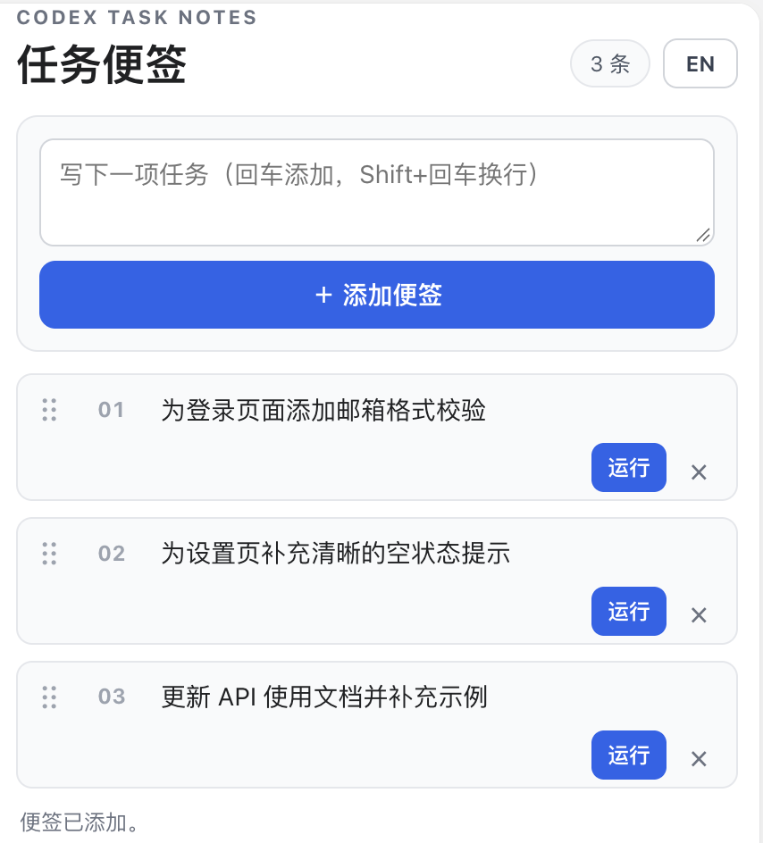

# 📝 Codex 任务便签

[English documentation](README.en.md)

> **把零散待办排成队，点一下就交给 Codex。** 写成一张张便签，拖动安排顺序；Codex 在当前对话里逐条处理，完成后自动归档。

🌏 中英切换　·　↕️ 拖动排序　·　💾 本机保存

适合把一个项目拆成连续的小步骤，按自己的节奏逐条推进。

## 👀 界面预览



> 右上角可切换界面语言；便签内容可使用任意语言。

## ✨ 功能亮点

- 🗒️ **便签式任务**：每条任务只有一个内容框，可添加、编辑、删除。
- ↕️ **拖动排优先级**：抓住左侧把手调整顺序，活动任务自动编号。
- ▶️ **点击交给 Codex**：任务作为用户消息发送到当前对话；成功发送后自动归档。
- 🌐 **中英文界面**：标题、按钮、提示和状态都可以切换；偏好保存在本机。
- 🔒 **本地任务列表**：任务内容与顺序保存在当前 Codex home，不会自动同步到其他设备或用户。

## ⚙️ 环境要求

- 支持本地插件和 MCP Apps 的 Codex 客户端。
- Node.js 命令 `node` 可从 `PATH` 中访问；无需安装 npm 依赖。

插件通过本地 `stdio` MCP 服务运行，面向本地 Codex 客户端；它不是托管的远端 MCP 服务。

## 🚀 从 GitHub 安装

```bash
codex plugin marketplace add https://github.com/wuxianpower/codex-task-queue-notes.git
codex plugin add codex-task-queue-spike@task-queue-spike-local
```

安装后重启 Codex，在对话中调用 `open_task_queue_board` 打开面板。

更新仓库内容后，刷新 marketplace 并重新安装：

```bash
codex plugin marketplace upgrade task-queue-spike-local
codex plugin add codex-task-queue-spike@task-queue-spike-local
```

## 🧭 使用方法

1. 调用 `open_task_queue_board` 打开任务面板。
2. 在顶部输入框写任务；按 **Enter** 添加，按 **Shift+Enter** 换行。
3. 点击便签内容编辑，拖动左侧把手调整顺序。
4. 点击 **运行**，把任务发送到当前对话；成功发送后它会移到归档区。
5. 点击右上角的 **EN / 中文** 切换界面语言。

首次运行且本机尚无任务文件时，会创建三条安全的示例便签；它们只请求 Codex 回复确认字符串，不会要求修改文件。

## 🔐 数据与隐私

- 默认数据文件：`~/.codex/task-queue-spike/tasks.json`。若设置了 `CODEX_HOME`，则保存在该目录下的 `task-queue-spike/tasks.json`。
- 每个用户或 Codex 环境各自保存一份列表，不会自动共享或同步。
- 点击 **运行** 时，便签内容会作为用户消息发送到当前 Codex 对话。
- 插件不连接第三方服务，也不把任务数据写入当前项目工作区。

## 🛠️ 本地开发

无需 npm 依赖。可运行内置检查器：

```bash
node --check server.mjs
node verify.mjs
```

## 📦 仓库说明

- 本目录同时是插件和 marketplace 根目录；catalog 位于 `.agents/plugins/marketplace.json`。
- 本项目提供本地 Node.js MCP 服务；多人不会共用同一份队列。

## 📄 许可证

尚未声明许可证。若要允许他人复用或分发代码，请由仓库所有者选择并添加许可证。
